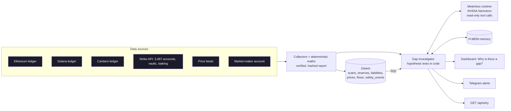
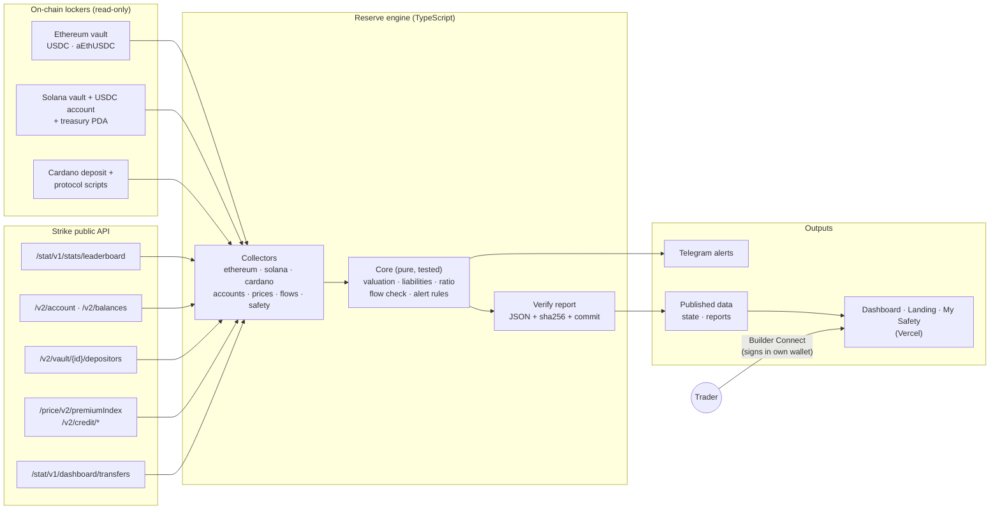
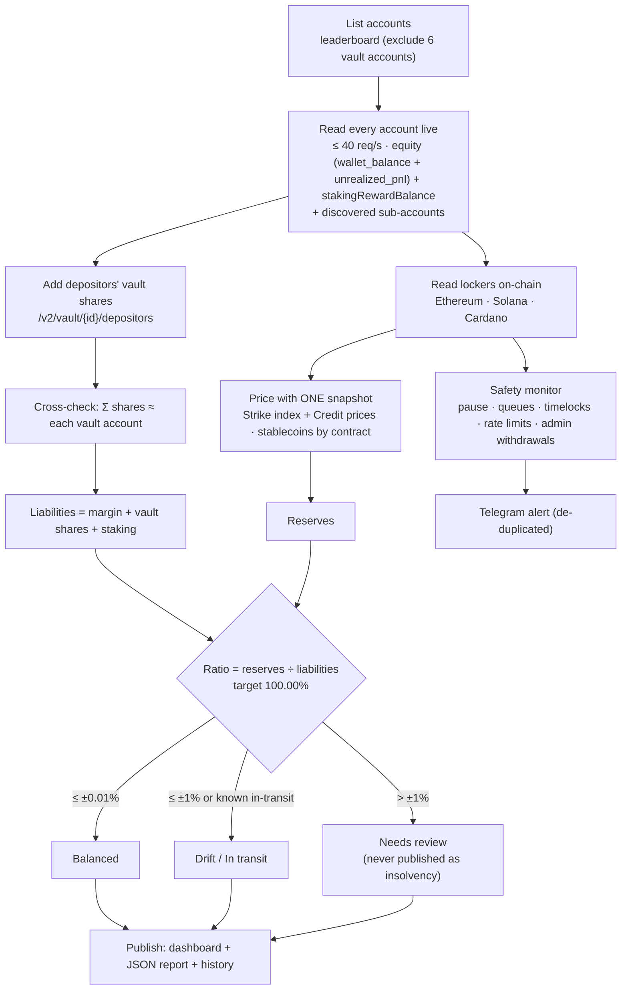
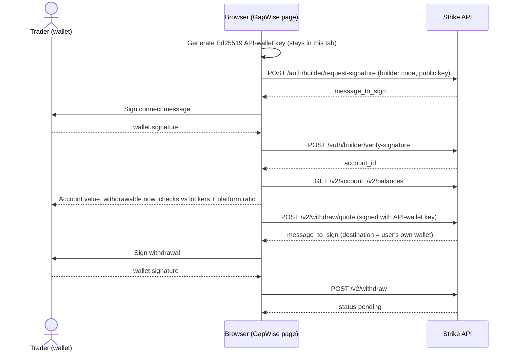
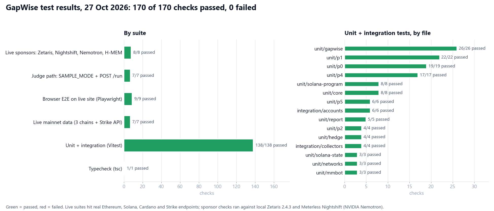

# GapWise — Understand Every Gap. Trust Every Finding.

**GapWise is an AI agent that checks whether a financial platform actually holds the money it owes its users. It
combines 5+ separate data sources, finds mismatches, and explains WHY, with evidence for every claim.**

**Live site:** https://gapwise-agent.vercel.app ([dashboard → "Why is there a gap?"](https://gapwise-agent.vercel.app/dashboard#why)) ·
**Demo video:** _added at submission_ · **Slides:** [`submission/GapWise.pptx`](submission/GapWise.pptx) ·
**Try it with no keys:** [Run it as a judge](#run-it-as-a-judge-no-credentials-needed)

> Independent project, not affiliated with Strike Finance. Built for the GenAI Works Open Agent Hackathon 2026
> (Track 02, "The Agent That Can Explain Why"). The data collectors and reserve maths were written before the build
> window and are declared as pre-existing; the agent and everything listed under "Built during the hackathon window" is new.

## The problem

A platform that holds customer money should be able to show that what it holds equals what it owes. When the two
numbers differ, a single ratio says *that* something is off, never *why*. Finding out means reconciling records that live
in different places: three public ledgers, a trading API with thousands of accounts, fund-share lists, price feeds and
an external trading account. Done by hand, each question took us days. The answer matters to **users** (is my money
there?), to **the platform** (what do we fix?) and to **auditors** (can I trust the explanation?).

## How GapWise fits Track 02

| Track 02 asks for | GapWise |
| --- | --- |
| Investigate across multiple sources | Ethereum, Solana and Cardano ledgers (reserves), Strike API accounts, vault depositors, staking, prices, market-maker account, previous scans, locker transaction logs, past findings in memory, SQL history in Zetaris |
| Connect findings | Tests 13 candidate causes in code, then the model can query more evidence with read-only tools; the change since the previous scan is split exactly into price, balance and liability parts |
| Evidence-backed answers | Every cause has a status (confirmed / supported / hypothesis / unresolved / ruled out), an amount computed in code and evidence ids (`sql`, `tx`, `source`). Answers with unknown ids, invented amounts or "fully explained" claims are rejected. The unexplained amount is never forced to zero |

## Architecture



## Sponsor technology: where and what

| Tech | Where in the code | What it does | Live status (27 Oct) |
| --- | --- | --- | --- |
| **Zetaris** (data layer) | `packages/zetaris/client.ts`, `store.ts`, `tables.ts`, `scripts/zetaris-setup.ts` | Each scan is written as six tables to a Postgres that Zetaris federates as the datasource `gapwise` (`CREATE DATASOURCE` + `REGISTER DATASOURCE TABLES`; Lightning has no `INSERT`). Everything the agent reads goes through Zetaris SQL: scan history, and the model's guarded `runSql` tool (one SELECT, GapWise tables only, row limit, every query logged with timing) | **Live**: local Zetaris 2.4.3; 9 reports / 18,741 rows published; Nemotron ran 3 SQL queries in one investigation |
| **Meterless Nightshift** (AI provider) | `packages/agent/llm.ts` | All model calls go to the Nightshift runtime (OpenAI-compatible, `127.0.0.1:8088/v1`, route `meterless/deep`), with tool calls; the first step must call a tool, at most 6 steps | **Live** |
| **Meterless H-MEM** (engine) | `packages/agent/memory.ts`, `packages/agent/hmem/` (reference implementation, Apache-2.0, unmodified) | Seeded with confirmed past findings; recalled before each investigation; each result saved. Test: `tests/unit/gapwise.test.ts` "seeds H-MEM once…" | **Live** |
| **NVIDIA Nemotron** | served through Nightshift (NVIDIA key in Nightshift's Providers tab, not in this repo); `inference.nemotron_verified` | Writes the explanation and picks the SQL queries. GapWise logs the model that served each request and shows "Nemotron verified" only when it names Nemotron | **Live**: `nvidia/nemotron-3.5-bolt-e4b`, `nemotron_verified: true` |
| **Cursor** | — | Optional; this work was written with Claude Code | — |

When Meterless or Zetaris is unavailable, results are labelled **rules-only**: the deterministic investigation, never a canned AI answer.

**Zetaris setup** (once): install Zetaris locally (Zetaris Cloud → Run locally), start the store Postgres on the
Zetaris network, fill `ZETARIS_*` and `GAPWISE_STORE_*` in `.env`, then run `npm run zetaris:setup`:

```bash
docker run -d --name gapwise-store --network zetaris_default -p 127.0.0.1:5433:5432 \
  -e POSTGRES_USER=gapwise -e POSTGRES_PASSWORD=<choose one> -e POSTGRES_DB=gapwise postgres:16-alpine
npm run zetaris:setup      # tables → datasource "gapwise" in Zetaris → publish reports → read back via Zetaris SQL
```

## The full agent loop on live data (27 Oct 2026, 15:09 UTC)

`npm run investigate` with Zetaris, Nightshift and H-MEM online, trace from `logs/` (summarised):

```
PlannerAgent   start              plan: history (Zetaris) → hypotheses in code → H-MEM → Nightshift → validator
EvidenceAgent  zetaris_query      SELECT scan_id, ts, gap_usd, status FROM gapwise.scans … → 5 scans
EvidenceAgent  test_hypotheses    confirmed 3, hypothesis 3, unresolved 1, ruled out 3; unexplained $20,862
MemoryAgent    hmem_recall        4 past findings recalled
ExplainerAgent nightshift_request asked for runSql ×3            [nvidia/nemotron-3.5-bolt-e4b]
EvidenceAgent  tool:runSql        FAILED: model guessed a column that does not exist; error returned to the model
EvidenceAgent  tool:runSql        gapwise.scans history → evidence E22
EvidenceAgent  tool:runSql        gapwise.liabilities for this scan → evidence E23
ExplainerAgent nightshift_request final answer drafted               [nvidia/nemotron-3.5-bolt-e4b]
ValidatorAgent critique           all claims backed by evidence
MemoryAgent    hmem_save          stored
```

Verdict written by Nemotron and accepted by the validator: *"The gap is not fully explained, as there is an
unresolved cause related to iUSD being counted at a placeholder price, and several other hypotheses remain
unconfirmed."* When an answer cites unknown evidence, quotes an amount the code did not compute, or claims the gap is
fully explained, the validator sends it back once for revision and otherwise keeps the computed result (unit tests
"logs named agents, a validator critique…" and "rejects fabricated evidence ids…"). Honest negations such as "not fully
explained" are accepted; an earlier version rejected them by mistake, which was found in live runs and fixed with a test.

Live site (last investigation, read-only): **https://gapwise-agent.vercel.app/dashboard#why**

## Example output (live mainnet scan, 27 Oct 2026 12:47 UTC, rules-only run before the sponsors were connected)

`npm run investigate -- --fresh` (trimmed; full output has every evidence item):

```json
{
 "investigation_id": "inv-b71f0afee52fc97f-20261027T124849",
 "scan_id": "b71f0afee52fc97f",
 "report_sha256": "b71f0afee52fc97f2357ad47ec7ad58f60dfff74daf7f0ee7beff6a2713158b5",
 "gap_usd": 20865.63,
 "verdict": "Reserves are $20,866 above what users are owed (+1.22%), status Needs review. Confirmed or supported causes account for $3; $20,862 is still unexplained. Open candidates: Funds in transit over the Cardano↔Ethereum bridge or an LP withdrawal ($10,000); Open trader profit whose losing side sits outside the lockers (−$1,933). Since the previous scan the gap changed by +$35,546; the largest part came from account equity owed to users (+$49,089 to the gap).",
 "model": "rules-only",
 "rules_only": true,
 "causes": [
  {
   "cause": "iUSD is counted at a placeholder price",
   "status": "unresolved",
   "usd": -7048.01,
   "confidence": "low",
   "evidence": [
    {
     "type": "source",
     "value": "report b71f0afee52fc97f · reserves.rows[iUSD].price_source = \"placeholder: iUSD: placeholder $1 until Strike c"
    }
   ]
  },
  {
   "cause": "Vault accounts hold more (or less) than the sum of their depositors' shares",
   "status": "confirmed",
   "usd": 3.4,
   "confidence": "high",
   "evidence": [
    {
     "type": "source",
     "value": "report b71f0afee52fc97f · result.vault_crosscheck.difference_usd = 3.4"
    }
   ]
  },
  {
   "cause": "Isolated margin missing from liabilities",
   "status": "rejected",
   "usd": 0,
   "confidence": "high",
   "evidence": [
    {
     "type": "source",
     "value": "report b71f0afee52fc97f · liabilities.isolated_margin_usd = 79555.58"
    }
   ]
  },
  {
   "cause": "Relayed deposits not counted in reserves",
   "status": "rejected",
   "usd": 0,
   "confidence": "high",
   "evidence": [
    {
     "type": "source",
     "value": "relayer 0x8f0eb9cacd6f35e2afb64f137fd1ba797fa1eca7 → Ethereum locker 0xbF4cFccd11257e568A936a7867D138f54A43cff"
    }
   ]
  },
  {
   "cause": "Commission balances not yet exposed by Strike",
   "status": "hypothesis",
   "usd": null,
   "confidence": "low",
   "evidence": [
    {
     "type": "source",
     "value": "report b71f0afee52fc97f · liabilities.commission_usd = null"
    }
   ]
  },
  {
   "cause": "Open trader profit whose losing side sits outside the lockers",
   "status": "hypothesis",
   "usd": -1933.22,
   "confidence": "low",
   "evidence": [
    {
     "type": "source",
     "value": "report b71f0afee52fc97f · Σ liabilities.accounts[].unrealized_pnl = 34265.58"
    }
   ]
  },
  {
   "cause": "Staking rewards funded from a wallet outside the lockers",
   "status": "rejected",
   "usd": 0,
   "confidence": "high",
   "evidence": [
    {
     "type": "source",
     "value": "report b71f0afee52fc97f · liabilities.staking_rewards_usd = 31689.74"
    }
   ]
  },
  {
   "cause": "Funds in transit over the Cardano↔Ethereum bridge or an LP withdrawal",
   "status": "hypothesis",
   "usd": 10000,
   "confidence": "low",
   "evidence": [
    {
     "type": "source",
     "value": "report b71f0afee52fc97f · result.in_transit.tolerance_usd = 10000"
    }
   ]
  }
 ],
 "unexplained_usd": 20862.23,
 "change_since_previous": {
  "delta_usd": 35545.7,
  "remainder_usd": 0
 },
 "next_check": "Match the in-transit bridge transfers on Cardano and Ethereum by transaction once Strike shares them."
}```

What it found: reserves are $20.9K **above** what is owed. Commission (not yet exposed) and in-transit bridge funds
are open candidates, staking and isolated margin are ruled out, and $20,862 stays unexplained. Since the previous
scan the gap moved +$35,546, split exactly (remainder $0) into price moves, a $59K USDCx balance change on Cardano
and changes in what accounts are owed.

## Built during the hackathon window (22–27 Oct 2026)

New: the Gap Investigator agent (`packages/agent/`), Zetaris data layer (`packages/zetaris/`), Meterless Nightshift client,
H-MEM memory, output validation, `GET /api/why` · `POST /api/why/run` · `GET /api/why/status`, the "Why is there a gap?"
dashboard panel, the explanation in alerts, `npm run investigate`, `POST /run` with `SAMPLE_MODE`, JSONL agent traces
and 26 new tests. Full list: [docs/hackathon/CHANGELOG.md](docs/hackathon/CHANGELOG.md).

Pre-existing (declared): the data collectors for the three ledgers and the platform API, the reserve and liability
maths, the hashed verify reports and the dashboard base. No formula or collector was changed for the hackathon.

## Setup

```bash
npm install
cp .env.example .env          # RPC keys optional; METERLESS_* and ZETARIS_* enable the AI and SQL layers
npm start                     # server + engine on http://localhost:8787 → /dashboard#why
npm run verify                # recompute the ratio from public data and write a hashed report
npm run investigate           # investigate the latest report (--fresh: live scan first, --publish: push tables to Zetaris)
npm test && npm run typecheck
```

### Run it as a judge (no credentials needed)

`SAMPLE_MODE=true` runs the same investigator on three real mainnet reports bundled in `input_examples/`, with no
Zetaris, no Nightshift and no RPC. It does real analysis on whatever report you send (it doesn't replay saved
outputs), and the result is labelled `rules-only`.

```bash
# Docker
docker build -t gapwise .
docker run --rm -p 8000:8787 -e SAMPLE_MODE=true gapwise
# or Node 20+
npm ci && SAMPLE_MODE=true PORT=8000 npm start

curl -X POST http://localhost:8000/run -H "Content-Type: application/json" -d @input_examples/example_1.json
```

`POST /run` takes a verified scan report (the format `npm run verify` writes), `{"scan_id": "<16 hex>"}`, or an empty
body for the latest report, and returns the investigation JSON. Bad input returns a 4xx with a message. The three
examples give three different results: example 1 −$63,087 Needs review, example 2 −$14,680 Drift, example 3 +$20,866
Needs review. The matching outputs and traces are in `output_examples/`.

**Traces.** Each run prints JSON lines to stdout and writes `logs/<investigation_id>.jsonl`. The agents named in the
trace are the investigator's stages, each one a separate function:

| Agent | Code | Does |
| --- | --- | --- |
| PlannerAgent | `investigate()` | Plans the run and picks the sources |
| EvidenceAgent | `analyzeGap`, Zetaris SQL, tools | Gathers history and tests each hypothesis in code |
| MemoryAgent | `GapMemory` (Meterless H-MEM) | Recalls similar past findings and saves the new one |
| ExplainerAgent | Meterless Nightshift client | Runs the model loop with read-only tools; logs the model that served each request |
| ValidatorAgent | `applyAnswer` | Rejects unknown evidence IDs or uncomputed amounts and sends the answer back for one revision |

With live sources, set `METERLESS_*` and `ZETARIS_*` in `.env`. Inside Docker, use `host.docker.internal` instead of
`127.0.0.1`.

Key env vars: `SAMPLE_MODE`, `METERLESS_BASE_URL`, `METERLESS_TOKEN` (read from the local runtime automatically), `METERLESS_MODEL`;
`ZETARIS_BASE_URL`, `ZETARIS_ORG_ID`, `ZETARIS_API_KEY` (or `ZETARIS_USERNAME`/`ZETARIS_PASSWORD`), `ZETARIS_SCHEMA`;
`GAPWISE_AUTO_INVESTIGATE`, `GAPWISE_AI=off` (force rules-only). See `.env.example`.

Hackathon docs: [requirements matrix](docs/hackathon/REQUIREMENTS-MATRIX.md) · [demo script](docs/hackathon/DEMO-SCRIPT.md) · [slide outline](docs/hackathon/SLIDE-DECK.md).

---

# Reference: how the reserve check works

[](https://github.com/Lakshmikanth-3/GapWise/actions/workflows/ci.yml)

The evidence GapWise investigates comes from a read-only reserve check: it counts every dollar in Strike's on-chain
lockers, counts every dollar Strike owes its users, and computes the gap. Anyone can re-run it with one command.

> Not affiliated with, endorsed by, or operated by Strike Finance (strikefinance.org, not the Bitcoin app "Strike").

## Data pipeline



Collectors only read; the core is pure functions; outputs only read stored results, so a slow chain never blanks the dashboard.
Scheduled GitHub Actions run the engine (`scan.yml`) and the public hourly verify (`verify.yml`).

## How a scan works



## My Safety flow (Builder Connect)



GapWise never sees a key that can move funds: Strike pays out only to the connected wallet, and only after the user signs.

## Latest result (23 Oct 2026, evening IST, `npm run verify`)

| | USD |
| --- | --- |
| Reserves: Ethereum, Solana and Cardano lockers | $1,696,613 |
| + Strike market-maker bot on external exchanges (Aster $34,196.04 · Lighter $1.00), **disclosed by Strike** | $34,197 |
| **Reserves total** | **$1,730,810.31** |
| Σ account equity (`wallet_balance + unrealized_pnl`, locked rewards and isolated margin included) | $632,637.47 |
| + Σ depositors' vault shares | $1,080,910.03 |
| + Σ staking rewards | $31,942.88 |
| + Commission | pending (not yet exposed by Strike) |
| **Liabilities** | **$1,745,490.38** (3,487 accounts read, 0 failed, 6 vault accounts excluded) |
| **Ratio** | **99.16%** · gap **−$14,680 (−0.84%)** → **Drift** |

**Transparency note (requested by Strike):** part of the reserves is held by Strike's market-maker bot
`0x6139…1937` on the Aster exchange. It is not an on-chain locker; GapWise reads it live through read-only API access that
Strike provided (keys are kept out of this repo), and shows it as its own line everywhere. Anyone can check the bot's link to
Strike on-chain: it deposits USDC into Strike's Ethereum locker for Strike account `019d06a7…`. Strike says the remaining
gap is funds being returned over the bridge today; GapWise re-runs automatically. Earlier steps of the investigation:
[docs/GAP-INVESTIGATION.md](docs/GAP-INVESTIGATION.md) and [docs/DECISIONS.md](docs/DECISIONS.md) #50–54. Live numbers:
the [dashboard](https://gapwise-agent.vercel.app/dashboard); history: `reports/` (local verify reports).

## Verify it yourself

```bash
git clone https://github.com/Lakshmikanth-3/GapWise && cd GapWise
npm install
npm run verify
```

No keys are needed. It scans every Strike account (about 3 minutes at ≤40 requests/s), reads every locker on-chain, and prints
reserves by chain and address, the liabilities (accounts read, vaults excluded, failures), the price snapshot used,
the ratio, and the gap in USD and %. It also writes **`reports/<network>-<timestamp>.json`**, a plain JSON file with
every input: addresses, raw on-chain balances, decimals, prices with sources and timestamps, every account's raw
`wallet_balance` / `unrealized_pnl` / `margin_balance` / `lockedRewards` / `stakingRewardBalance`, every depositor's vault share, the per-vault cross-check,
open notes, the code commit and a `content_sha256`. Diff it against any
published scan: the dashboard's **Download this scan (JSON)** button, `GET /api/report`, or the hourly files in the
`reports` branch.

## What GapWise checks

1. **Reserves:** on-chain balances of every Strike locker, priced in USD.
2. **Liabilities:** what Strike owes users, summed live account by account from Strike's public API.
3. **Ratio = reserves ÷ liabilities.** Strike is not a CEX, so the target is **exactly 100.00%**. Above is as suspicious as below.
4. **Flow match:** Strike-reported daily deposits and withdrawals per chain vs what actually moved on-chain.
5. **Safety controls:** vault pause state, queued large withdrawals, timelocked changes, upgrades, admin withdrawals and
   rate-limit usage on Ethereum (ABI-decoded events and state) and Solana (IDL-decoded accounts and instructions), with
   real-time Telegram alerts.
6. **My Safety (`/me`):** a trader connects a wallet through Strike Builder Connect, sees their balance backed by the
   lockers, and can withdraw by signing in their own wallet (proven on Strike testnet).

## The exact formula

```
reserves    = Σ over lockers, assets:  amount × price
              amount  = raw on-chain integer ÷ 10^decimals   (Credit custody assets: Strike's raw_amount_scale)
              price   = Strike index price (ADA, ETH, SOL) | Strike Credit price (sUSDrf, LP, scaled aUSDC)
                        | 1.00 for fiat-redeemable stablecoins by contract (USDC, USDT, USDCx, USDM)
                        | iUSD: labelled $1 placeholder (price source pending) | anything else unpriced → excluded
liabilities = Σ (wallet_balance + unrealized_pnl)    account equity, every non-vault account + sub-accounts
                                                  (locked rewards and isolated margin included; NOT margin_balance)
            + Σ depositors' current vault shares  GET /v2/vault/{id}/depositors current_equity (not inside equity)
            + Σ stakingRewardBalance              GET /v2/balances (withdrawable; not inside wallet_balance)
            + commission                          pending: not yet exposed by Strike (no value added)
ratio       = reserves ÷ liabilities                gap = reserves − liabilities  (USD and % of liabilities)
status      = Balanced |gap| ≤ 0.01% · Drift ≤ 1% · Needs review > 1% (never published as insolvency)
              · In transit when |gap| ≤ the founder-stated in-transit amount ($10,000)
```

One price snapshot values every reserve row; it is taken right after the account scan, and both are timestamped.

## Addresses and endpoints

| Locker | Address | Holds (23 Oct) |
| --- | --- | --- |
| Ethereum vault | [`0xbF4cFccd11257e568A936a7867D138f54A43cffa`](https://etherscan.io/address/0xbF4cFccd11257e568A936a7867D138f54A43cffa) | USDC, aEthUSDC (Aave V3) |
| Solana vault account | [`Dj9NkHyMMLyQGnYz2necVuHF6ELXqxUa3EsRZNHiPrrt`](https://solscan.io/account/Dj9NkHyMMLyQGnYz2necVuHF6ELXqxUa3EsRZNHiPrrt) | SOL (rent); owns the USDC token account |
| Solana USDC token account | [`BT85fgyhyZhCtaNdciKEGoj7mU8E3EeFijPy6XCmCAA6`](https://solscan.io/account/BT85fgyhyZhCtaNdciKEGoj7mU8E3EeFijPy6XCmCAA6) | USDC |
| Solana treasury PDA | [`H4nZyX3qGQwGH6wQn8G53uZ6LX8TqPZDakCN2M54icSH`](https://solscan.io/account/H4nZyX3qGQwGH6wQn8G53uZ6LX8TqPZDakCN2M54icSH) | SOL |
| Cardano deposit script | [`addr1w9yg…kls3`](https://cardanoscan.io/address/addr1w9ygqdx9law3waqgm6eamf2xhxs5x83r0pfka928jmydkuc6ykls3) | ADA, USDM, USDCx, sUSDrf, LP_SUNDAE_USDCx_USDM, iUSD |
| Cardano protocol script | [`addr1w9m5…7jf2`](https://cardanoscan.io/address/addr1w9m5m4v8vfpq74n6cd0z33r3jlatfkfsykpcjaxze8af33qxh7jf2) | ADA, USDM |

Solana program `7XASQ24fiwoNHmTnQdi3k3WXMUXRaj7MdcHvkSducrB8` (IDL `strike_vault`, `packages/collectors/abi/`).
Ethereum vault ABI: `packages/collectors/abi/ethereum-vault.json`.

| Purpose | Strike endpoint (public, no key) |
| --- | --- |
| Account list | [`GET /stat/v1/stats/leaderboard`](https://docs.strikefinance.org/api/platform-stats/leaderboard.md) (ids only; balances lag) |
| Account value | [`GET /v2/account?account_id=`](https://docs.strikefinance.org/api/user/rest-api/account.md) → `wallet_balance`, `unrealized_pnl` (equity), `sub_accounts` |
| Rewards | `GET /v2/balances?account_id=` → `lockedRewards`, `stakingRewardBalance` |
| Vault shares | [`GET /v2/vault/{id}/depositors`](https://docs.strikefinance.org/api/vaults/vaults-public.md) → `current_equity` per depositor |
| Index prices | [`GET /price/v2/premiumIndex`](https://docs.strikefinance.org/api/market/rest-api/prices.md) |
| Credit prices | [`GET /v2/credit/collateral-assets`](https://docs.strikefinance.org/api/credit/collateral.md) |
| Custody mapping | [`GET /v2/credit/settings`](https://docs.strikefinance.org/api/credit/settings.md) → `custody_asset_mappings` |
| Reported flows | [`GET /stat/v1/dashboard/transfers`](https://docs.strikefinance.org/api/platform-stats/platform-dashboard.md) |
| My Safety | [Builder Connect](https://docs.strikefinance.org/api/builder-codes.md) `/auth/builder/*`, `/v2/withdraw/*` (registered builder code) |

## Founder-confirmed rules (Strike Finance, 21–23 Oct 2026)

- **Account value = equity = `wallet_balance + unrealized_pnl`** (23 Oct). `margin_balance` is not used: it equals
  `available_balance` and leaves out isolated-margin positions ($77K across 47 accounts, found by a manual check).
- **Vault accounts are excluded** (no double counting), but a user's equity does **not** include their vault deposits,
  so each depositor's current vault share is added. Cross-check: Σ depositor shares ≈ each vault account's equity (within $3).
- **iUSD** counts as a reserve; it is valued at a labelled $1 placeholder until Strike confirms its price source.
- **Coverage:** the leaderboard lists every account that has or once had a balance; accounts not on it never deposited.
- **All rewards are owed:** staking rewards (`stakingRewardBalance`, not inside wallet_balance) are added; locked rewards
  are already inside wallet_balance and counted once. Commission balances are withdrawable too: pending until Strike exposes them.
- **Both Cardano scripts** count (deposit + protocol).
- **Both Solana addresses** count: the vault account `Dj9NkHy…` and the USDC token account `BT85fg…`, de-duplicated.
- **Prices** for sUSDrf, the SundaeSwap LP token and scaled aUSDC come from Strike's Credit API, never an assumed $1.
- **Relayed deposits:** deposits from chains without their own locker (Solana via relayer `0x8f0e…eca7`, base, bsc,
  polygon …) arrive as USDC in the Ethereum locker. The daily flow match compares them as one "Solana + relayed" row
  (22 Oct: 2,447.28 reported vs 2,447.45 on-chain, 99.99%).
- **Strike's market-maker bot** (`0x6139…1937`) holds the other side of traders' positions on Lighter and Aster. Its
  equity counts as a **separate, disclosed reserve line**, not an on-chain locker (founder, 23 Oct 18:43). Lighter is read
  from its public API; Aster through read-only API access provided by Strike (kept out of the repo). Its link to Strike is
  on-chain: it deposits into Strike's Ethereum locker for Strike account `019d06a7…`.
- **In-transit LP/IOG bridge gaps** are rare (a one-time event every few months) and shown as a note only.
- Rate limit: ≤ 40 requests/second to Strike (the founder asked for under 50).

## Known limits

- **In-transit funds:** a large LP withdrawal on Ethereum, and Cardano USDCx deposits / USDC withdrawals bridged back
  through the IOG bridge, can leave a temporary gap of a few thousand dollars. It is shown as "Known in-transit", never added.
- **Price movement between scans:** the account scan takes about 3 minutes, and Strike values accounts with live prices while
  GapWise uses one snapshot right after the scan. Small residual gaps (tens to hundreds of dollars) are expected.
- **Commission pending:** commission balances are owed but not yet exposed by Strike, so liabilities are slightly understated
  until they are. The MARKET WIZARDS vault shows a small (~$400) account-vs-depositors difference, acknowledged by Strike.
- Free public RPCs can be slow or rate-limited; optional free-tier keys make scans faster.

## Testnet view

The same engine also runs against **Strike's testnet** (`GAPWISE_NETWORK=testnet`, dashboard `/dashboard?network=testnet`):
Sepolia vault `0x879e450F2482a2DEcbd27176A4c177e69Bd7A0E6`, Solana devnet vault `Di862rQJwGgMLtrchoBfkcehEKXPpYnppeA9Gmxtasin`
(program `FSNjjtrZP2BiuPfyRjTWQUybN8QNnEQgUogho79SMzXt`), Cardano preprod script `addr_test1wpuakhm8ftcwy2t00vhxp3rmqev90cs5xqf6ynu7f7rxrrg4rlm70`,
and Strike's testnet accounts. It is clearly labelled as test funds and never alerts the public channel. Testnet balances are
faucet-credited, so the testnet ratio is not meaningful; mainnet is the published proof. All write actions (My Safety
withdrawals) were tested on testnet first. `GAPWISE_NETWORK=testnet npm run verify` reproduces it.

## Run the live monitor

```bash
cp .env.example .env    # optional keys, all free tiers
npm start               # http://localhost:8787  (/, /dashboard, /me, /api/state, /api/report)
```

| Optional key (free tier) | Effect |
| --- | --- |
| `ETH_RPC_URL` (Alchemy) | Faster Ethereum state reads (logs use a wide-range public RPC) |
| `SOLANA_RPC_URL` (Alchemy or Helius) | Avoids public Solana rate limits |
| `BLOCKFROST_PROJECT_ID` | Cardano via Blockfrost instead of public Koios |
| `TELEGRAM_BOT_TOKEN` / `TELEGRAM_CHAT_ID` | Alert delivery |
| `STRIKE_BUILDER_CODE` | Enables My Safety (Builder Connect) |
| `DATABASE_URL` (Supabase) | Postgres history (`packages/db/schema.sql`); otherwise `data/*.jsonl` |

Deployment: Vercel serves the pages and read-only API (https://gapwise-agent.vercel.app).
Any always-on host can instead run `docker build -t gapwise . && docker run -p 8787:8787 --env-file .env gapwise`.

## Tests

```bash
npm test             # unit + mocked integration (recorded real fixtures; no network) — runs in CI on every push
npm run test:live    # mainnet smoke tests
npm run test:e2e     # Playwright against a running server (GAPWISE_URL=…)
npm run test:t6.6    # fresh clone + npm install + npm run verify with no keys, compared with the live dashboard
```

**Latest full run (27 Oct 2026): 170 of 170 checks passed.** Typecheck, 138 unit and integration tests, 7 live mainnet
tests, 9 browser tests against https://gapwise-agent.vercel.app, 7 judge-path checks (`SAMPLE_MODE` + `POST /run`,
including bad input) and 8 live sponsor checks (Zetaris SQL, Nightshift, Nemotron verified, model logged per request,
H-MEM, validator, five agents in the trace). Raw results: [`docs/testing/test-results.json`](docs/testing/test-results.json).



## Security

Read-only: the server answers GET requests only, and no key that can move funds is ever stored. For My Safety, the Ed25519
API-wallet key is generated in the browser and never leaves the tab; withdrawals go only to the user's own wallet and need
the user's own signature. No secrets are committed (`.env` is git-ignored; `.env.example` holds placeholders only).

## Docs

`docs/PRD.md` (plan) · `docs/DECISIONS.md` (every decision and finding, with evidence) · `docs/PROGRESS.md` (phase log and
test results) · `docs/MANUAL-CHECKS.md` (explorer and app spot checks).

## Licence

MIT. See `LICENSE`.
