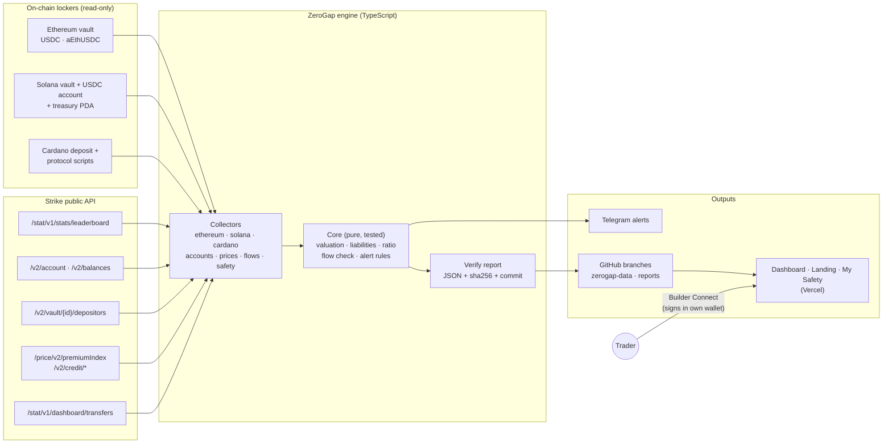
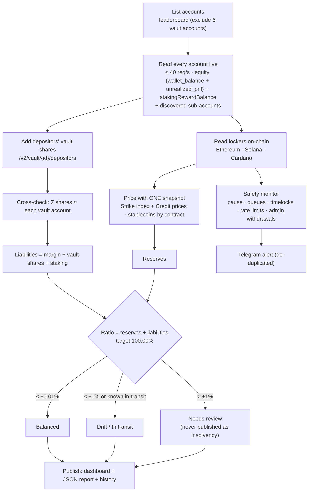
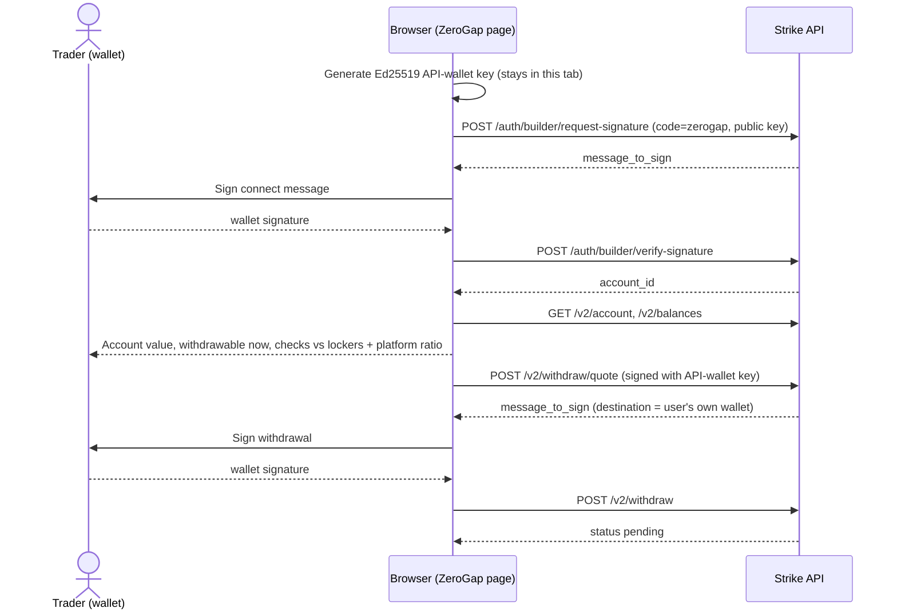

# ZeroGap

[](https://github.com/Lakshmikanth-3/ZeroGap/actions/workflows/ci.yml) [](https://github.com/Lakshmikanth-3/ZeroGap/actions/workflows/scan.yml) [](https://github.com/Lakshmikanth-3/ZeroGap/actions/workflows/verify.yml)

**Every dollar on Strike, proven on-chain.** ZeroGap is an independent, open-source, read-only proof-of-solvency and
safety monitor for [Strike Finance](https://docs.strikefinance.org/). It counts every dollar in Strike's on-chain lockers,
counts every dollar Strike owes its users, and shows the gap live. Anyone can re-run the whole check with one command.

> **ZeroGap is an independent project. It is not affiliated with, endorsed by, or operated by Strike Finance.**
> (Strike Finance is strikefinance.org, not the Bitcoin app "Strike".)

Live: **https://zerogap-strike.vercel.app** · Alerts: **https://t.me/zerogap_alerts** · Scan history: [`reports` branch](https://github.com/Lakshmikanth-3/ZeroGap/tree/reports)

## Hackathon submission at a glance

| | |
| --- | --- |
| **Problem** | Strike V2 trades off-chain on the Strike Node, while user funds sit in on-chain lockers. Nobody could independently check that the lockers hold what Strike owes. |
| **Solution** | ZeroGap reads every locker on Ethereum, Solana and Cardano, sums every account from Strike's public API, and publishes a live reserve ratio (target exactly 100%), flow match, safety alerts and a personal "My Safety" check. Fully reproducible with one command. |
| **Result** | **96.58%**, under review with Strike: $1.784M in lockers vs $1.847M owed to 3,477 accounts. ZeroGap's own manual check found that `margin_balance` leaves out isolated-margin positions ($77K); Strike's founder confirmed the fix (account equity), and the Strike team is now investigating the remaining gap. Per-vault cross-check matches to $3. |
| **Strike integrations** | Locker contracts on 3 chains (ABI- and IDL-decoded) · leaderboard, `/v2/account`, `/v2/balances` · vault depositors · price feed + Credit prices · transfers stats · **Builder Connect** (builder code `zerogap`, testnet withdrawal proven) |
| **Links** | Live: https://zerogap-strike.vercel.app · Alerts: https://t.me/zerogap_alerts · Verify: `npm run verify` |
| **Quality** | 105 unit/integration tests + Playwright E2E + live mainnet smoke + fresh-clone verification (T6.6), all in CI |

## How ZeroGap meets the judging criteria

| Criterion | ZeroGap |
| --- | --- |
| **Innovation and creativity** | The first independent proof-of-solvency for a hybrid DEX: an off-chain order book checked against on-chain lockers on three chains at once, with a target of exactly 100% (over is as suspicious as under). |
| **Integration with Strike** | Reads Strike's locker contracts on Ethereum, Solana and Cardano (ABI and IDL decoded); the leaderboard, `/v2/account`, `/v2/balances`, vault depositors, price index, Credit prices and transfer stats; **Builder Connect** with registered builder code `zerogap` for My Safety (testnet withdrawal proven). |
| **Utility and impact** | Traders can see that their money is backed, check their own account, and withdraw. Strike gets public, reproducible proof of reserves plus 24/7 safety alerts. It already found real issues: flow mismatches, and isolated-margin balances missing from `margin_balance` ($77K, fix confirmed by Strike's founder). |
| **Technical execution** | TypeScript monorepo; read-only collectors; pure, tested core; 112 unit and integration tests, Playwright E2E, a live smoke test and a fresh-clone verify, all in CI; live on Vercel with scheduled GitHub Actions; every number carries its source, timestamp and confidence. |
| **Future potential** | Can become Strike's public transparency page: per-user proofs, more chains and lockers as Strike adds them, an alerting API for partners, and hourly signed reports already published to the `reports` branch. |

## Architecture



Collectors only read; the core is pure functions; outputs only read stored results, so a slow chain never blanks the dashboard.
Scheduled GitHub Actions run the engine (`scan.yml`) and the public hourly verify (`verify.yml`).

## How a scan works



## My Safety flow (Builder Connect)



ZeroGap never sees a key that can move funds: Strike pays out only to the connected wallet, and only after the user signs.

## Latest result (23 Oct 2026, 06:07 UTC, `npm run verify`)

| | USD |
| --- | --- |
| **Reserves** | **$1,783,641.09** (Ethereum, Solana, Cardano lockers) |
| Σ account equity (`wallet_balance + unrealized_pnl`, locked rewards and isolated margin included) | $729,897.39 |
| (of which isolated margin that `margin_balance` leaves out) | ($77,247.71) |
| + Σ depositors' vault shares | $1,084,855.52 |
| + Σ staking rewards | $31,975.53 |
| + Commission | pending (not yet exposed by Strike) |
| **Liabilities** | **$1,846,728.44** (3,477 accounts read, 0 failed, 6 vault accounts excluded) |
| **Ratio** | **96.58%** · gap **−$63,087 (−3.42%)** → **Under review with Strike** |

**Under review with Strike: the gap is being investigated by the Strike team.** It is not a statement of insolvency.
Switching to account equity (founder-confirmed, 23 Oct) made every vault account match the sum of its depositors' shares
to within $3 in total, a strong sign that the account side is now measured correctly. Open items: commission balances
(pending from Strike) and the iUSD price ($5.7K at a $1 placeholder). Live numbers: the
[dashboard](https://zerogap-strike.vercel.app/dashboard); history: the
[`reports` branch](https://github.com/Lakshmikanth-3/ZeroGap/tree/reports).

## Verify it yourself

```bash
git clone https://github.com/Lakshmikanth-3/ZeroGap && cd ZeroGap
npm install
npm run verify          # or: npx zerogap verify
```

No keys are needed. It scans every Strike account (about 3 minutes at ≤40 requests/s), reads every locker on-chain, and prints
reserves by chain and address, the liabilities (accounts read, vaults excluded, failures), the price snapshot used,
the ratio, and the gap in USD and %. It also writes **`reports/<network>-<timestamp>.json`**, a plain JSON file with
every input: addresses, raw on-chain balances, decimals, prices with sources and timestamps, every account's raw
`wallet_balance` / `unrealized_pnl` / `margin_balance` / `lockedRewards` / `stakingRewardBalance`, every depositor's vault share, the per-vault cross-check,
open notes, the code commit and a `content_sha256`. Diff it against any
published scan: the dashboard's **Download this scan (JSON)** button, `GET /api/report`, or the hourly files in the
`reports` branch.

## What ZeroGap checks

1. **Reserves:** on-chain balances of every Strike locker, priced in USD.
2. **Liabilities:** what Strike owes users, summed live account by account from Strike's public API.
3. **Ratio = reserves ÷ liabilities.** Strike is not a CEX, so the target is **exactly 100.00%**. Above is as suspicious as below.
4. **Flow match:** Strike-reported daily deposits and withdrawals per chain vs what actually moved on-chain.
5. **Safety controls:** vault pause state, queued large withdrawals, timelocked changes, upgrades, admin withdrawals and
   rate-limit usage on Ethereum (ABI-decoded events and state) and Solana (IDL-decoded accounts and instructions), with
   real-time Telegram alerts.
6. **My Safety (`/me`):** a trader connects a wallet through Strike Builder Connect, sees their balance backed by the
   lockers, and can withdraw by signing in their own wallet (proven on Strike testnet).

## The exact formula

```
reserves    = Σ over lockers, assets:  amount × price
              amount  = raw on-chain integer ÷ 10^decimals   (Credit custody assets: Strike's raw_amount_scale)
              price   = Strike index price (ADA, ETH, SOL) | Strike Credit price (sUSDrf, LP, scaled aUSDC)
                        | 1.00 for fiat-redeemable stablecoins by contract (USDC, USDT, USDCx, USDM)
                        | iUSD: labelled $1 placeholder (price source pending) | anything else unpriced → excluded
liabilities = Σ (wallet_balance + unrealized_pnl)    account equity, every non-vault account + sub-accounts
                                                  (locked rewards and isolated margin included; NOT margin_balance)
            + Σ depositors' current vault shares  GET /v2/vault/{id}/depositors current_equity (not inside equity)
            + Σ stakingRewardBalance              GET /v2/balances (withdrawable; not inside wallet_balance)
            + commission                          pending: not yet exposed by Strike (no value added)
ratio       = reserves ÷ liabilities                gap = reserves − liabilities  (USD and % of liabilities)
status      = Balanced |gap| ≤ 0.01% · Drift ≤ 1% · Needs review > 1% (never published as insolvency)
              · In transit when |gap| ≤ the founder-stated in-transit amount ($10,000)
```

One price snapshot values every reserve row; it is taken right after the account scan, and both are timestamped.

## Addresses and endpoints

| Locker | Address | Holds (23 Oct) |
| --- | --- | --- |
| Ethereum vault | [`0xbF4cFccd11257e568A936a7867D138f54A43cffa`](https://etherscan.io/address/0xbF4cFccd11257e568A936a7867D138f54A43cffa) | USDC, aEthUSDC (Aave V3) |
| Solana vault account | [`Dj9NkHyMMLyQGnYz2necVuHF6ELXqxUa3EsRZNHiPrrt`](https://solscan.io/account/Dj9NkHyMMLyQGnYz2necVuHF6ELXqxUa3EsRZNHiPrrt) | SOL (rent); owns the USDC token account |
| Solana USDC token account | [`BT85fgyhyZhCtaNdciKEGoj7mU8E3EeFijPy6XCmCAA6`](https://solscan.io/account/BT85fgyhyZhCtaNdciKEGoj7mU8E3EeFijPy6XCmCAA6) | USDC |
| Solana treasury PDA | [`H4nZyX3qGQwGH6wQn8G53uZ6LX8TqPZDakCN2M54icSH`](https://solscan.io/account/H4nZyX3qGQwGH6wQn8G53uZ6LX8TqPZDakCN2M54icSH) | SOL |
| Cardano deposit script | [`addr1w9yg…kls3`](https://cardanoscan.io/address/addr1w9ygqdx9law3waqgm6eamf2xhxs5x83r0pfka928jmydkuc6ykls3) | ADA, USDM, USDCx, sUSDrf, LP_SUNDAE_USDCx_USDM, iUSD |
| Cardano protocol script | [`addr1w9m5…7jf2`](https://cardanoscan.io/address/addr1w9m5m4v8vfpq74n6cd0z33r3jlatfkfsykpcjaxze8af33qxh7jf2) | ADA, USDM |

Solana program `7XASQ24fiwoNHmTnQdi3k3WXMUXRaj7MdcHvkSducrB8` (IDL `strike_vault`, `packages/collectors/abi/`).
Ethereum vault ABI: `packages/collectors/abi/ethereum-vault.json`.

| Purpose | Strike endpoint (public, no key) |
| --- | --- |
| Account list | [`GET /stat/v1/stats/leaderboard`](https://docs.strikefinance.org/api/platform-stats/leaderboard.md) (ids only; balances lag) |
| Account value | [`GET /v2/account?account_id=`](https://docs.strikefinance.org/api/user/rest-api/account.md) → `wallet_balance`, `unrealized_pnl` (equity), `sub_accounts` |
| Rewards | `GET /v2/balances?account_id=` → `lockedRewards`, `stakingRewardBalance` |
| Vault shares | [`GET /v2/vault/{id}/depositors`](https://docs.strikefinance.org/api/vaults/vaults-public.md) → `current_equity` per depositor |
| Index prices | [`GET /price/v2/premiumIndex`](https://docs.strikefinance.org/api/market/rest-api/prices.md) |
| Credit prices | [`GET /v2/credit/collateral-assets`](https://docs.strikefinance.org/api/credit/collateral.md) |
| Custody mapping | [`GET /v2/credit/settings`](https://docs.strikefinance.org/api/credit/settings.md) → `custody_asset_mappings` |
| Reported flows | [`GET /stat/v1/dashboard/transfers`](https://docs.strikefinance.org/api/platform-stats/platform-dashboard.md) |
| My Safety | [Builder Connect](https://docs.strikefinance.org/api/builder-codes.md) `/auth/builder/*`, `/v2/withdraw/*` (builder code `zerogap`) |

## Founder-confirmed rules (Strike Finance, 21–23 Oct 2026)

- **Account value = equity = `wallet_balance + unrealized_pnl`** (23 Oct). `margin_balance` is not used: it equals
  `available_balance` and leaves out isolated-margin positions ($77K across 47 accounts, found by ZeroGap's manual check).
- **Vault accounts are excluded** (no double counting), but a user's equity does **not** include their vault deposits,
  so each depositor's current vault share is added. Cross-check: Σ depositor shares ≈ each vault account's equity (within $3).
- **iUSD** counts as a reserve; it is valued at a labelled $1 placeholder until Strike confirms its price source.
- **Coverage:** the leaderboard lists every account that has or once had a balance; accounts not on it never deposited.
- **All rewards are owed:** staking rewards (`stakingRewardBalance`, not inside wallet_balance) are added; locked rewards
  are already inside wallet_balance and counted once. Commission balances are withdrawable too: pending until Strike exposes them.
- **Both Cardano scripts** count (deposit + protocol).
- **Both Solana addresses** count: the vault account `Dj9NkHy…` and the USDC token account `BT85fg…`, de-duplicated.
- **Prices** for sUSDrf, the SundaeSwap LP token and scaled aUSDC come from Strike's Credit API, never an assumed $1.
- **In-transit LP/IOG bridge gaps** are rare (a one-time event every few months) and shown as a note only.
- Rate limit: ≤ 40 requests/second to Strike (the founder asked for under 50).

## Known limits

- **In-transit funds:** a large LP withdrawal on Ethereum, and Cardano USDCx deposits / USDC withdrawals bridged back
  through the IOG bridge, can leave a temporary gap of a few thousand dollars. It is shown as "Known in-transit", never added.
- **Price movement between scans:** the account scan takes about 3 minutes, and Strike values accounts with live prices while
  ZeroGap uses one snapshot right after the scan. Small residual gaps (tens to hundreds of dollars) are expected.
- **Commission pending:** commission balances are owed but not yet exposed by Strike, so liabilities are slightly understated
  until they are. The MARKET WIZARDS vault shows a small (~$400) account-vs-depositors difference, acknowledged by Strike.
- Free public RPCs can be slow or rate-limited; optional free-tier keys make scans faster.

## Testnet view

The same engine also runs against **Strike's testnet** (`ZEROGAP_NETWORK=testnet`, dashboard `/dashboard?network=testnet`):
Sepolia vault `0x879e450F2482a2DEcbd27176A4c177e69Bd7A0E6`, Solana devnet vault `Di862rQJwGgMLtrchoBfkcehEKXPpYnppeA9Gmxtasin`
(program `FSNjjtrZP2BiuPfyRjTWQUybN8QNnEQgUogho79SMzXt`), Cardano preprod script `addr_test1wpuakhm8ftcwy2t00vhxp3rmqev90cs5xqf6ynu7f7rxrrg4rlm70`,
and Strike's testnet accounts. It is clearly labelled as test funds and never alerts the public channel. Testnet balances are
faucet-credited, so the testnet ratio is not meaningful; mainnet is the published proof. All write actions (My Safety
withdrawals) were tested on testnet first. `ZEROGAP_NETWORK=testnet npm run verify` reproduces it.

## Run the live monitor

```bash
cp .env.example .env    # optional keys, all free tiers
npm start               # http://localhost:8787  (/, /dashboard, /me, /api/state, /api/report)
```

| Optional key (free tier) | Effect |
| --- | --- |
| `ETH_RPC_URL` (Alchemy) | Faster Ethereum state reads (logs use a wide-range public RPC) |
| `SOLANA_RPC_URL` (Alchemy or Helius) | Avoids public Solana rate limits |
| `BLOCKFROST_PROJECT_ID` | Cardano via Blockfrost instead of public Koios |
| `TELEGRAM_BOT_TOKEN` / `TELEGRAM_CHAT_ID` | Alert delivery |
| `STRIKE_BUILDER_CODE` | Enables My Safety (Builder Connect) |
| `DATABASE_URL` (Supabase) | Postgres history (`packages/db/schema.sql`); otherwise `data/*.jsonl` |

Deployment: Vercel serves the pages and read-only API. The `ZeroGap engine` workflow runs one engine cycle on a schedule
and publishes state to the `zerogap-data` branch. The `Hourly verify` workflow appends a verify report to the `reports` branch.
Any always-on host can instead run `docker build -t zerogap . && docker run -p 8787:8787 --env-file .env zerogap`.

## Tests

```bash
npm test             # unit + mocked integration (recorded real fixtures; no network) — runs in CI on every push
npm run test:live    # mainnet smoke tests
npm run test:e2e     # Playwright against a running server (ZEROGAP_URL=…)
npm run test:t6.6    # fresh clone + npm install + npm run verify with no keys, compared with the live dashboard
```

## Security

Read-only: the server answers GET requests only, and no key that can move funds is ever stored. For My Safety, the Ed25519
API-wallet key is generated in the browser and never leaves the tab; withdrawals go only to the user's own wallet and need
the user's own signature. No secrets are committed (`.env` is git-ignored; `.env.example` holds placeholders only).

## Docs

`docs/PRD.md` (plan) · `docs/DECISIONS.md` (every decision and finding, with evidence) · `docs/PROGRESS.md` (phase log and
test results) · `docs/MANUAL-CHECKS.md` (explorer and app spot checks) · `docs/design/ZeroGap UI.html` (design).

## Licence

MIT. See `LICENSE`.
